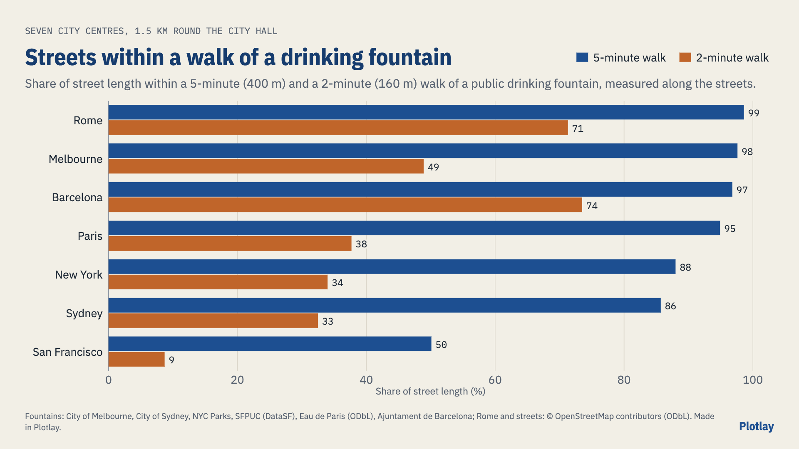

# A drink within five minutes: seven city centres

How much of each city's centre is within a 5-minute walk of a public drinking fountain? Melbourne, Sydney, New York, San Francisco, Paris, Barcelona and Rome, the same size each: everything within 1.5 km of the city hall, measured along the streets. **Live version, with an interactive map:** [getplotlay.com/showcase/drinking-fountains](https://www.getplotlay.com/showcase/drinking-fountains/)



A 5-minute walk is 400 m at 4.8 km/h. **In Rome 98.6% of the street length in the centre is that close to a fountain, in Melbourne 97.6% and in Barcelona 96.8%; Paris 94.9%, New York 88.0%, Sydney 85.7% and San Francisco 50.1%.** Within 2 minutes (160 m) the cities spread out: Barcelona 73.5%, Rome 71.3%, Melbourne 48.9%, down to San Francisco at 8.7%.

Each city publishes its fountains differently (Melbourne every unit, Sydney the council's own, New York the Parks department's, San Francisco mixed with toilets, Paris under a share-alike licence, Rome with no open licence), and none says how much of the city is within reach of one. Here the same rule picks the fountains in every city, and [Plotlay](https://www.getplotlay.com)'s walking catchments measure each one along OpenStreetMap's streets.

[](https://app.plotlay.io/?example=drinking-fountains&as=client)

## What the data says

| City | Streets within 5 min | Within 2 min | Residents within 5 min | Fountains | Per km² | Street km |
|---|---|---|---|---|---|---|
| Rome | 98.6% | 71.3% | 99.7% | 210 | 30 | 147.2 |
| Melbourne | 97.6% | 48.9% | 99.5% | 122 | 18 | 153.2 |
| Barcelona | 96.8% | 73.5% | 98.8% | 180 | 28.1 | 146.8 |
| Paris | 94.9% | 37.7% | 95.8% | 103 | 14.6 | 149.4 |
| New York | 88.0% | 34.0% | 92.6% | 95 | 18.9 | 93.6 |
| Sydney | 85.7% | 32.5% | 89.5% | 84 | 12.7 | 131 |
| San Francisco | 50.1% | 8.7% | 62.4% | 26 | 3.7 | 146.6 |

- **San Francisco's centre is the least served.** 26 fountains in its study area, 3.7 a km²; in the Mission part only 27.8% of streets are within 5 minutes.
- **Sydney's gaps are partly its list.** The council's list leaves out the state's precincts (Darling Harbour, Barangaroo). With OpenStreetMap's drinking water points instead, Sydney has 95.9%.
- **Rome and Barcelona have the most fountains:** 30 and 28.1 a km², so most streets are within 2 minutes of one.

### Read it carefully

- **Each city records different things**: New York's list is parks only; Sydney's is the council's own; Barcelona's has no park or status field. Indoor fountains, sinks, dog bowls and units out of service or outside the city are left out everywhere.
- **Winter**: many fountains in New York and the European cities are turned off over winter; these shares count them all as on. Paris's list marked 9 of the 133 used unavailable on the day it was downloaded (94.0% without them).
- **Streets** are OpenStreetMap's, as of 2026-11-08: the walk uses every footpath and lane, but only street centrelines are counted (central Melbourne maps footpaths as separate ways; counting them would give 375.6 km instead of 153.2 km).
- **Residents are modelled** (GHS-POP 2020, 100 m): each square counts by the share of its streets in reach.

## How it was made with Plotlay

1. **A map project** and a **Districts** data layer: each city's district file taken all at once, keyed by its code.
2. **Cities**: the seven study areas, with the city results linked by key.
3. **Fountains as points**: each city's list taken all at once into its own layer.
4. **Walking catchments**: 5 minutes at 4.8 km/h, **Count: streets only**, **within: Districts**. Every district gets the share of its street length in reach (`reached_pct`).
5. **Colour** the districts by that share; **charts and map pictures** in the Analysis workspace; **export** GeoJSON, TopoJSON and CSV.

The numbers in `data/` come from the same engine (`src/core/catchment.js` in Plotlay) run on the same OpenStreetMap extract, and the app's district values were checked against them.

## What's here

| Folder | What |
|---|---|
| [`data/tables/`](data/tables) | `cities.csv` (one row per city) and `districts.csv` (one row per district) |
| [`data/fountains/`](data/fountains) | `fountains.csv`: every fountain used, with its source and position |
| [`data/geometry/`](data/geometry) | The districts (key `key`, as `MEL-Carlton`): GeoJSON, TopoJSON, CSV with WKT; `study_areas.geojson` |
| [`data/streets/`](data/streets) | The street centrelines measured in each study area, reached or not |
| [`python/`](python) | A narrated notebook that recomputes the shares from the street lengths: [`drinking_fountains.ipynb`](python/drinking_fountains.ipynb) |
| [`powerbi/`](powerbi) | A Power BI Project (`.pbip`). Start with [`powerbi/OPEN-ME.md`](powerbi/OPEN-ME.md) |
| [`visuals/`](visuals) | The map pictures and charts, made in Plotlay |

### Run the notebook

```
python3 -m venv .venv
.venv/bin/pip install -r python/requirements.txt
cd python && ../.venv/bin/jupyter lab drinking_fountains.ipynb
```

## Sources and licences

- **Code** (notebook, Power BI project): MIT, see [`LICENSE`](LICENSE).
- **Data** (`data/`): the Open Database Licence (ODbL 1.0), see [`LICENSE-DATA`](LICENSE-DATA), because it is made from OpenStreetMap's streets, the Paris data and Rome's OpenStreetMap fountains, all ODbL. **Visuals**: CC BY 4.0 with the same credits.
- Fountains: City of Melbourne, City of Sydney, Ajuntament de Barcelona (CC BY 4.0); NYC Parks (NYC Open Data); San Francisco Public Utilities Commission, DataSF (PDDL 1.0); Eau de Paris, Paris Data (ODbL 1.0). Districts: CLUE small areas, City villages, 2020 NTAs, Analysis Neighborhoods, quartiers administratifs (ODbL), barris; Rome's rioni from OpenStreetMap. Streets: © OpenStreetMap contributors. Residents: GHS-POP R2023A, European Commission JRC. Full wording in [`NOTICE`](NOTICE).

This is independent work using open data, not endorsed by any of the cities.
